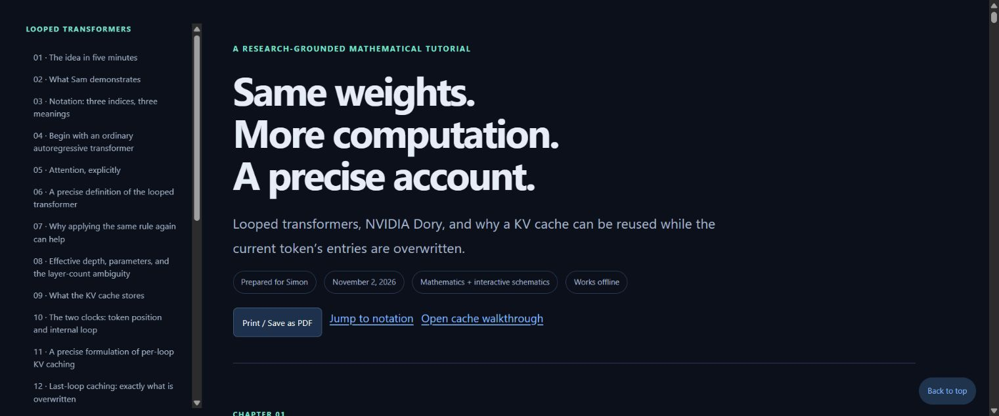

# Dory: The Looped Transformer

[**Read the live interactive tutorial →**](https://az9713.github.io/dory-the-looped-transformer/)

A mathematical and visual guide to looped transformers, NVIDIA Dory, and the key-value (KV) cache. The tutorial combines an explanation of Sam’s demonstrations with primary-source research and a precise account of recurrence and attention-cache behavior.

## What is included

- 24 chapters, a symbol glossary, and 32 display equations.
- Standard attention and Dory’s recurrent update, with generic formulas distinguished from implementation details.
- Per-loop versus last-loop KV caching, including an interactive walkthrough.
- Effective depth, parameter sharing, memory use, compute cost, training, and stopping criteria.
- NVIDIA-reported benchmarks, research context, and clearly labeled limitations.
- Dark-mode styling and embedded mathematical fonts; the tutorial works offline.

## Inspiration and references

- **Video inspiration:** [Sam’s tutorial on NVIDIA Dory and looped transformers](https://www.youtube.com/watch?v=vSCYL8ySh9g&t=10s).
- **Model reference:** [NVIDIA’s Nemotron Labs Dory collection on Hugging Face](https://huggingface.co/collections/nvidia/nemotron-labs-dory).
- Additional official implementation sources and primary research are linked in the tutorial.

Our contribution is the consolidated tutorial, expanded mathematical formulations, cache-indexing explanation, and interactive teaching diagrams. This repository is an educational companion; it does not distribute model weights or claim independent reproduction of NVIDIA’s benchmark results.

## Read locally

Download [index.html](index.html) and open it in a browser. No installation or build is required. Mathematics and interactions are embedded; following external source links requires internet access.

## GitHub Pages

The live tutorial is served from `index.html` on the `main` branch at the repository root. The `.nojekyll` file keeps this a plain static site.

## Third-party notices

The HTML embeds KaTeX fonts and generated mathematical markup. The KaTeX MIT license is included in the document.
